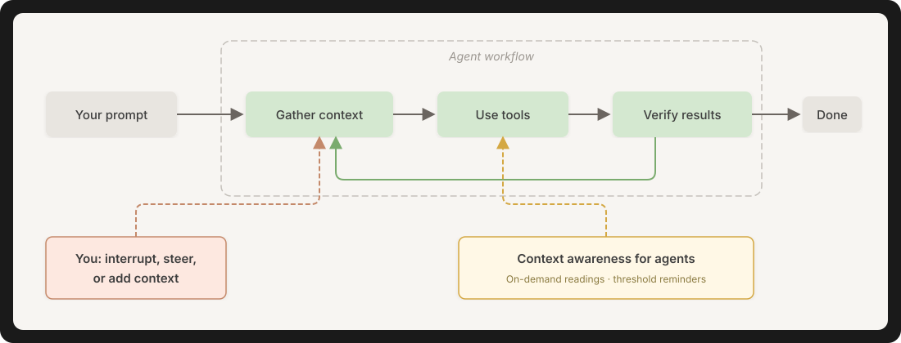

# Context awareness for agents

Context awareness informs your agent how much of the context window it has
used and injects instructions to the conversation when usage crosses thresholds
you choose. It supports Claude Code and Codex, and requires Bash 3.2 or later
and jq.

<p align="center">
  
</p>

## Install

<details>
<summary><strong>Claude Code</strong></summary>

Run in Claude Code and choose user-wide or project scope when installing:

```text
/plugin marketplace add sdi2200262/context-awareness-for-agents
/plugin install context-awareness@context-awareness-for-agents
```

</details>

<details>
<summary><strong>Codex</strong></summary>

Run in a terminal:

```sh
codex plugin marketplace add sdi2200262/context-awareness-for-agents
codex plugin add context-awareness@context-awareness-for-agents
```

Restart Codex and trust the plugin's hook in `/hooks` to enable reminders.
Codex also needs permission to run the skill's shell command.

</details>

## Configure

Readings come from the latest usage your assistant has recorded; they may
lag behind the conversation's latest API calls. Skills and hook reminders
include percentages, token counts, the capacity model preset, the recorded
model and the config path for correcting a mismatch.

By default the plugin injects a reminder to the conversation at 70% of these
capacities.

| Assistant | Default model | Usable context window |
| --- | --- | --- |
| Claude Code | Opus 5.5 | About 967,000 tokens from a 1M window |
| Codex | GPT-6.1 Sol | 475,000 tokens from a 500k window |

Claude's capacity follows its compaction threshold; Codex's follows its usable
window, with compaction occurring earlier.

Choose a capacity matching your setup for the plugin's percentages and reminders.
Codex keeps its selected capacity when you switch models; for a configured 272k
window, select `assistant_limit = codex-272k` in `capacity.conf`.

The installed plugin loads configuration files directly for capacity, with model presets,
assistant limits and comments:

- [claude/capacity.conf](claude/capacity.conf)
- [codex/capacity.conf](codex/capacity.conf)

The shared [src/config.default.json](src/config.default.json) handles the context threshold reminders,
messages and repeat behavior. Edit these files in the installed plugin to change its defaults. **A plugin
update can replace your edits.**

`config.json` takes these fields:

| Field | Values |
| --- | --- |
| `hooks` | `false` turns reminders off. Omitted means on. |
| `thresholds` | A list of `percent`, a unique `level` and a `message`. Messages can use `{percentage}`, `{remaining}` and `{session_id}`. |
| `repeat_mode` | `once_per_tier` sends each level once per session. `once_per_tier_reset_on_compaction`, the default, sends it again after compaction or after usage drops below it. `every_turn` sends it on every tool call at or above it. |
| `flag_dir` | Absolute directory for reminder state. The default is `/tmp`. |

To keep settings across updates, save your own `capacity.conf` or
`config.json` in the user directory. For one project, save it in the project
directory instead:

| Scope | Claude Code | Codex |
| --- | --- | --- |
| All projects | `${CLAUDE_CONFIG_DIR:-~/.claude}/context-awareness/` | `${CODEX_HOME:-~/.codex}/context-awareness/` |
| One project | `.claude/context-awareness/` | `.codex/context-awareness/` |

Claude resolves project settings from `CLAUDE_PROJECT_DIR`, the session's
starting project root. Codex searches from the working directory up to the
nearest Git root for `.codex/context-awareness/`.

Each file is selected on its own: a path in `CONTEXT_CAPACITY_CONFIG` or
`CONTEXT_THRESHOLDS_CONFIG`, then the project file, then the user file, then
the bundled file. The selected file replaces the others whole, so you should
include every setting you need. **Changes apply on the next tool call.**

**Each assistant keeps separate settings and reminder state.**

### Skill-only mode

To keep the skill and turn reminders off, use a `config.json` containing:

```json
{"hooks": false}
```

An empty `"thresholds": []` has the same effect. Hooks then skip session
reads and keep their reminder state. Because the project file takes precedence,
a project can turn reminders off while they are on globally, or on while they
are off, without reinstalling. To turn them on, the project's `config.json`
needs its own thresholds, such as the contents of `src/config.default.json`;
`{"hooks": true}` alone is incomplete.

## License

[MIT](LICENSE).

<p align="center">
  <a href="https://github.com/sdi2200262" target="_blank">
    
  </a>
</p>
